# RL_T3 — Unreal Engine × Python Q-learning

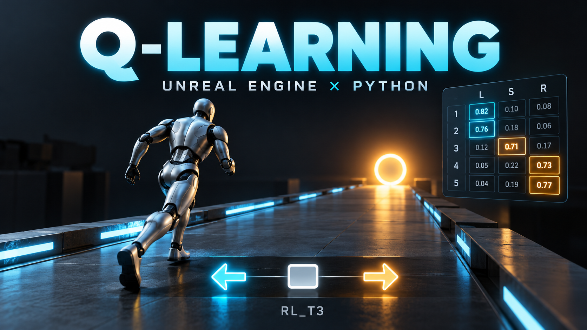

*표지는 프로젝트 콘셉트 이미지이며, 표지 속 숫자는 실제 학습 결과가 아닌 시각적 예시입니다.*

Unreal Engine에서 움직이는 에이전트가 목표 위치로 이동한 뒤 정지하는 행동을 학습하는 강화학습 실습 프로젝트입니다. Unreal Engine은 환경과 보상 계산을, Python은 행동 선택과 Q-table 갱신을 담당합니다. 두 프로세스는 Windows 공유 메모리와 Named Event로 통신합니다.

신경망을 사용하는 DQN이 아닌 **표 기반 Q-learning**입니다. PyTorch 텐서로 5개 상태 × 3개 행동의 Q값을 저장합니다.

## 프로젝트 구성

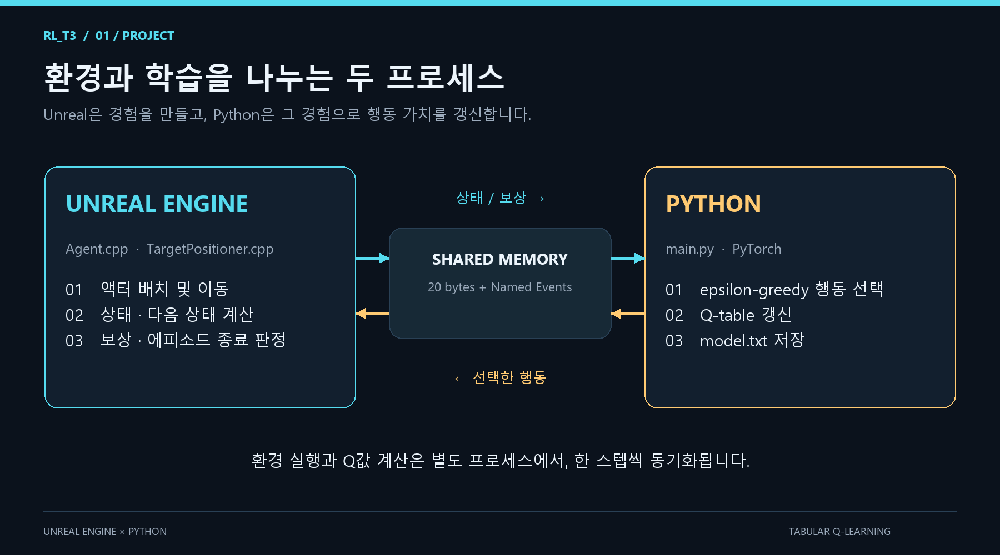

```text
RL_T3/
├── README.md
├── Asset/2D/                  # README용 PNG 이미지와 도식 생성 스크립트
├── RL_T3_PY/
│   ├── main.py                 # 공유 메모리 연결, 행동 선택, 학습, 결과 저장
│   ├── pyproject.toml          # Python 버전 및 의존성
│   ├── uv.lock                 # 의존성 잠금 파일
│   ├── test.py                 # PyTorch DLL 및 import 확인용 스크립트
│   ├── testroom.py             # 텐서 연산 실험용 스크립트
│   └── data/model.txt          # 정상 학습 종료 시 생성되는 Q-table
├── RL_T3_UE/
│   ├── RL_T3_UE.uproject
│   ├── Source/RL_T3_UE/
│   │   ├── Agent.h             # 에이전트, 작업 스레드, 공유 메모리 구조
│   │   ├── Agent.cpp           # 환경 진행, 이동, 상태·보상 계산
│   │   └── TargetPositioner.cpp
│   └── Content/ProjectContent/
│       ├── Blueprint/         # BP_Agent, BP_TargetPositioner
│       └── Level/LV_Main.umap  # 기본 레벨
└── Video/                     # 로컬 실행 녹화
```

## 실행 환경

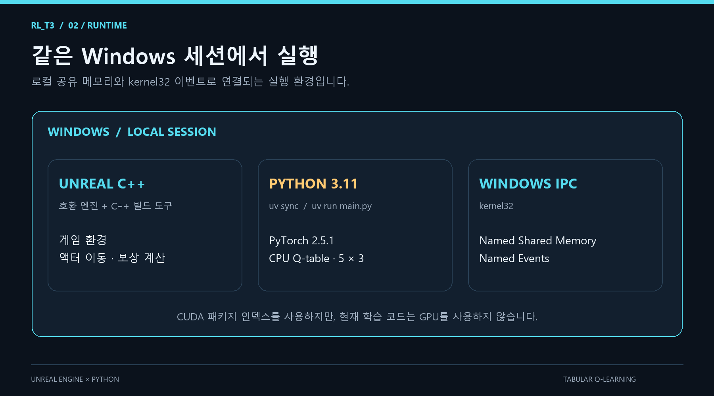

- **Windows**: `kernel32`, Windows 파일 매핑, Named Event를 사용합니다.
- **Unreal Engine C++ 빌드 환경**: 현재 Target 파일은 `BuildSettingsVersion.V7`과 `EngineIncludeOrderVersion.Unreal5_8`을 지정합니다. 이에 맞는 엔진과 C++ 도구 체인이 필요합니다.
- **Python 3.11**: 지원 범위는 `>=3.11,<3.12`, `.python-version`은 `3.11.14`입니다.
- **uv**: Python 의존성을 설치하고 실행합니다.
- **PyTorch 2.5.1**: torchvision 0.20.1, torchaudio 2.5.1도 의존성에 포함됩니다.

`.uproject`의 엔진 연결은 로컬 GUID로 저장되어 있습니다. 다른 PC에서는 설치된 호환 엔진에 프로젝트를 연결하고 프로젝트 파일을 다시 생성해야 할 수 있습니다.

의존성은 PyTorch CUDA 12.4 인덱스를 사용하도록 설정되어 있지만, 현재 Q-table은 기본 CPU 텐서이며 학습 코드에서 CUDA를 사용하지 않습니다.

## 실행 방법

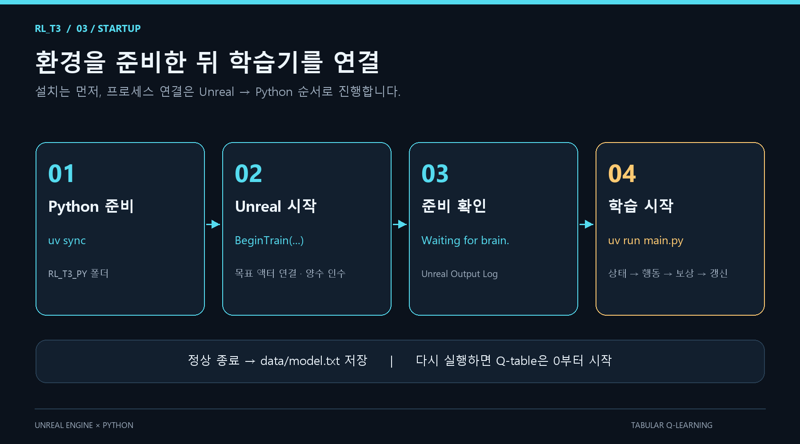

### 1. Python 환경 준비

저장소 루트의 PowerShell에서 실행합니다.

```powershell
cd RL_T3_PY
uv sync
```

### 2. Unreal 환경 시작

1. `RL_T3_UE/RL_T3_UE.uproject`를 호환 엔진으로 열고 C++ 모듈을 빌드합니다.
2. 기본 레벨 `LV_Main`을 엽니다.
3. 에이전트의 `TargetPositioner` 참조에 목표 액터가 연결되어 있는지 확인합니다.
4. 플레이를 시작하고 Blueprint에서 에이전트의 `BeginTrain(NewMaxEpisode, NewMaxSteps)`가 호출되도록 합니다. 두 인수는 양의 정수로 지정합니다.
5. Output Log에서 `Waiting for brain.`을 확인합니다.

`BeginTrain()`이 공유 메모리와 이벤트를 준비하는 작업 스레드를 시작합니다. C++의 `BeginPlay()`에는 자동 학습 시작 코드가 없으므로, 플레이만으로 시작되는지는 Blueprint의 호출 연결에 달려 있습니다.

### 3. Python 학습 시작

Unreal이 준비된 상태에서 `RL_T3_PY` 폴더의 터미널에서 실행합니다.

```powershell
uv run main.py
```

Python을 먼저 실행하면 Unreal이 만드는 이벤트나 공유 메모리를 찾지 못할 수 있습니다. 동일한 Windows 사용자 세션에서 Unreal과 Python을 각각 하나씩 실행합니다.

정상 종료되면 `RL_T3_PY/data/model.txt`에 학습 결과가 저장됩니다. 경로는 스크립트 위치가 아닌 **현재 작업 디렉터리**를 기준으로 하며, 기존 파일은 덮어씁니다.

## 학습 환경

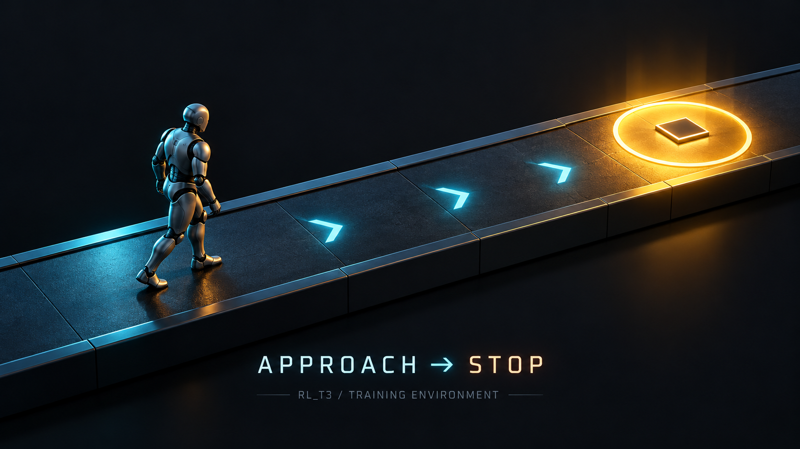

*목표에 접근한 뒤 정지하는 과제를 표현한 일러스트이며, 실제 Unreal 실행 화면은 아닙니다.*

각 에피소드가 시작되면 에이전트와 목표 위치를 X축 약 `-1000 ~ 1000` 범위에서 무작위로 배치합니다. 에이전트는 목표와의 X축 거리로 상태를 판단합니다.

```text
Distance = Target.X - Agent.X
```

### 상태와 행동

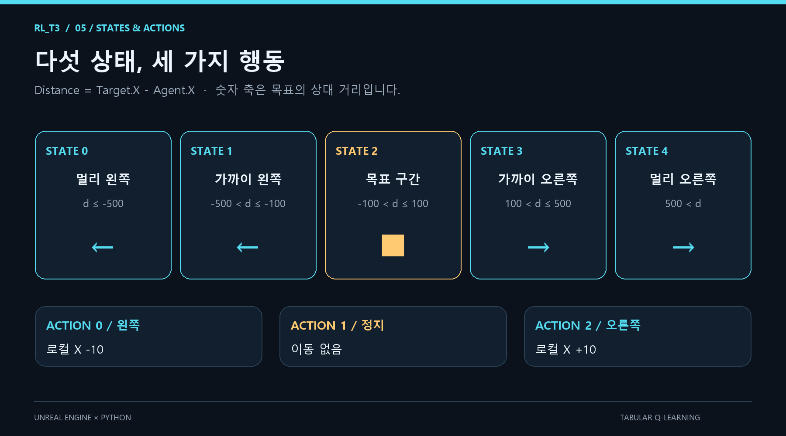

| 상태 번호 | 거리 조건 | 의미 | 기대하는 greedy 행동 |
|---|---|---|---|
| 0 | `Distance <= -500` | 목표가 멀리 왼쪽 | 왼쪽 이동 |
| 1 | `-500 < Distance <= -100` | 목표가 가까이 왼쪽 | 왼쪽 이동 |
| 2 | `-100 < Distance <= 100` | 목표 구간 안 | 정지 |
| 3 | `100 < Distance <= 500` | 목표가 가까이 오른쪽 | 오른쪽 이동 |
| 4 | `500 < Distance` | 목표가 멀리 오른쪽 | 오른쪽 이동 |

| 행동 번호 | 행동 | 현재 이동량 |
|---|---|---|
| 0 | 왼쪽 이동 | 로컬 X축 `-10` 유닛 |
| 1 | 정지 | 이동 없음 |
| 2 | 오른쪽 이동 | 로컬 X축 `+10` 유닛 |

상태는 월드 X축으로 계산하지만 이동은 `AddActorLocalOffset()`을 사용합니다. 위 방향 관계는 에이전트의 로컬 X축이 월드 X축과 일치하는 배치를 전제로 합니다. 

### 보상과 종료

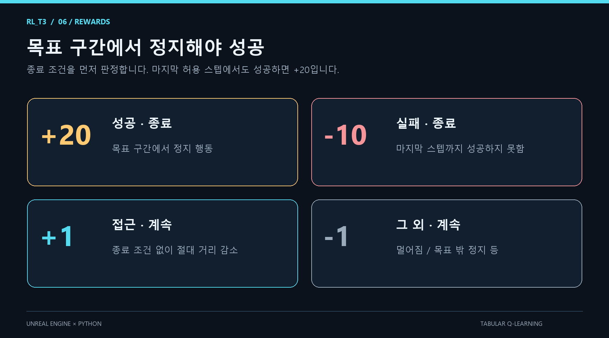

| 조건 | 보상 | 에피소드 종료 |
|---|---:|---|
| 목표 구간에서 정지 행동 선택 | `+20` | 예 |
| 마지막 허용 스텝까지 성공하지 못함 | `-10` | 예 |
| 종료 조건에 해당하지 않고 목표까지의 절대 거리가 감소 | `+1` | 아니요 |
| 그 외 행동 | `-1` | 아니요 |

목표 구간에 진입하는 것만으로 성공하지 않습니다. **구간 안에서 정지 행동을 선택해야 성공**합니다. 마지막 허용 스텝에서도 성공 조건을 만족하면 `+20`을 받습니다. 일반 스텝에서는 거리 변화가 1유닛 이내이면 움직이지 않은 것으로 판정합니다.

`MaxEpisode`와 `MaxSteps`의 C++ 생성자 기본값은 각각 10, 50입니다. 실제 학습에는 `BeginTrain()`으로 전달한 값이 적용됩니다.

현재 이동량은 10유닛이므로, 기본 50스텝으로는 모든 시작 위치에서 성공할 수 없습니다. 예를 들어 목표가 오른쪽으로 1000유닛 떨어져 있으면 목표 구간 진입까지 최소 90번 이동하고 정지 1번을 해야 합니다. 탐험 중에는 더 많은 스텝이 필요할 수 있습니다.

## Q-learning

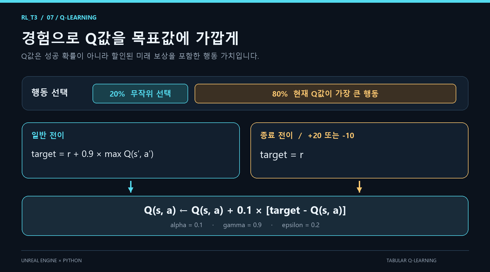

| 설정 | 값 | 의미 |
|---|---:|---|
| Q-table 크기 | `5 × 3` | 상태별 행동 가치 |
| 초기 Q값 | `0` | 실행할 때마다 새로 초기화 |
| 학습률 `alpha` | `0.1` | 새로운 타깃의 반영 비율 |
| 할인율 `gamma` | `0.9` | 미래 보상의 할인 비율 |
| 탐험률 `epsilon` | `0.2` | 무작위 행동을 선택할 확률 |

20% 확률로 세 행동 중 하나를 균등하게 선택하고, 나머지 80%에서는 현재 상태의 Q값이 가장 큰 행동을 선택합니다. 무작위 선택에서도 최댓값 행동이 뽑힐 수 있으므로 epsilon은 실패 확률이 아닙니다.

갱신식은 다음과 같습니다.

```text
종료 전이: target = reward
일반 전이: target = reward + gamma × max Q(next_state, action)

Q(state, action) ← Q(state, action) + alpha × (target − Q(state, action))
```

현재 구현에서는 보상이 `+20` 또는 `-10`이면 종료 전이로 처리합니다. 성공·실패용 Q-table 행은 따로 만들지 않으며, 종료 전이에서는 다음 상태 가치를 더하지 않습니다. 보상 체계를 변경할 때는 이 종료 판정도 함께 수정해야 합니다.

## Unreal–Python 통신

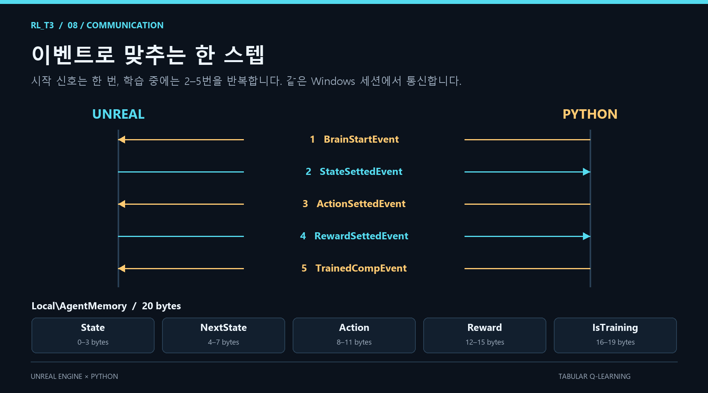

공유 메모리 이름은 `Local\AgentMemory`, 크기는 20바이트입니다.

| 바이트 오프셋 | 필드 | Unreal 타입 | 의미 |
|---|---|---|---|
| 0–3 | `State` | `uint32` | 행동 전 상태 |
| 4–7 | `NextState` | `uint32` | 행동 후 상태 |
| 8–11 | `Action` | `uint32` | Python이 선택한 행동 |
| 12–15 | `Reward` | `float` | 행동에 대한 보상 |
| 16–19 | `IsTraining` | `uint32` | 전체 학습 진행 여부, 1 또는 0 |

Python은 정수 필드를 little-endian `<i`, 보상을 `<f`로 읽습니다. 현재 사용하는 작은 비음수 정수 범위에서는 Unreal의 정수 표현과 호환됩니다. `IsTraining`은 개별 에피소드 종료 여부가 아니라 **전체 학습**의 진행 여부입니다.

프로세스 간 이벤트 이름에는 모두 `Local\` 접두사가 붙습니다.

| 순서 | 발신 → 수신 | 이벤트 | 처리 내용 |
|---|---|---|---|
| 1 | Python → Unreal | `BrainStartEvent` | 연결 완료, 학습 시작 |
| 2 | Unreal → Python | `StateSettedEvent` | 현재 상태 전달 |
| 3 | Python → Unreal | `ActionSettedEvent` | 선택한 행동 전달 |
| 4 | Unreal → Python | `RewardSettedEvent` | 행동 결과와 보상 전달 |
| 5 | Python → Unreal | `TrainedCompEvent` | Q값 갱신 완료 |

학습 중에는 2–5번을 반복합니다. Unreal의 작업 스레드는 통신을 처리하고, 액터 위치 변경과 상태 측정은 `AsyncTask`를 통해 게임 스레드에서 수행합니다.

## 학습 결과 읽기

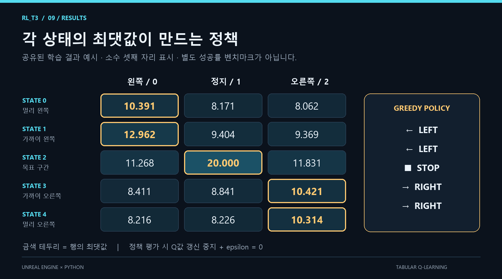

`model.txt`는 헤더 없는 쉼표 구분 텍스트입니다. 행은 상태 0–4, 열은 행동 0–2 순서입니다. 다음은 공유된 학습 결과를 소수 셋째 자리로 반올림한 예시입니다. 이 문서의 기본 설정으로 재현한 벤치마크는 아닙니다.

```text
10.391,8.171,8.062
12.962,9.404,9.369
11.268,20.000,11.831
8.411,8.841,10.421
8.216,8.226,10.314
```

각 행에서 최댓값인 열을 선택하면 `[0, 0, 1, 2, 2]`, 즉 **왼쪽 → 왼쪽 → 정지 → 오른쪽 → 오른쪽** 정책을 얻습니다. 이 예시는 모든 상태에서 의도한 행동을 최선으로 선택합니다.

Q값은 성공 확률이 아니라 할인된 미래 보상을 포함한 행동 가치입니다. 잘못된 방향으로 한 번 움직여도 이후 돌아와 성공할 수 있기 때문에 다른 행동의 값도 양수일 수 있습니다. 최댓값과 나머지 값의 차이만으로 학습 성공이나 안정성을 판단하지 않습니다.

실제 성능은 저장된 Q-table을 고정하고 `epsilon=0`으로 여러 무작위 시작 위치에서 평가해야 합니다. 성공률, 성공까지의 평균 스텝, 시작 거리별 실패 횟수를 기록하면 정책의 성능과 스텝 제한의 영향을 구분할 수 있습니다.

**현재 코드에는 저장 모델 로딩, 평가 전용 모드, 성공률 집계가 없습니다.** `main.py`를 다시 실행하면 Q-table이 0으로 초기화됩니다. 평가하려면 로딩과 Q값 갱신 비활성화 처리를 추가해야 하며, epsilon만 0으로 바꾸는 것으로는 평가 모드가 되지 않습니다.

## 현재 한계와 문제 해결

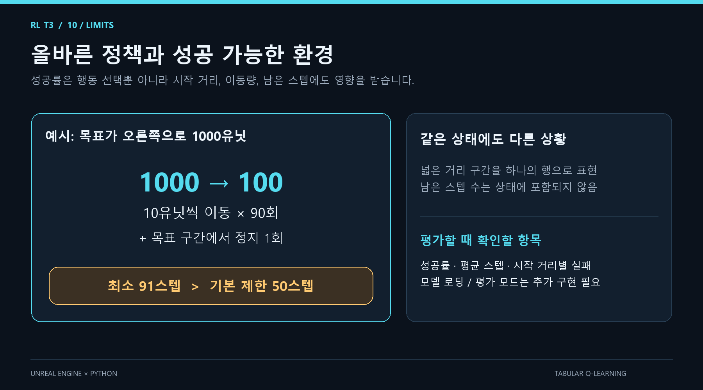

- **상태 표현:** 넓은 거리 구간과 서로 다른 남은 스텝 수를 같은 상태로 취급합니다. 같은 행에 성공 가능한 상황과 시간 부족 상황의 경험이 섞일 수 있습니다.
- **고정 학습률:** 학습률과 탐험률의 감소 스케줄이 없습니다. 오래 학습해도 최근 경험에 따라 Q값은 계속 변할 수 있습니다.
- **종료 시 동기화:** 현재 Unreal은 `RewardSettedEvent`를 보낸 뒤 최종 `IsTraining=0`을 기록합니다. Python이 먼저 종료 플래그를 읽으면 다음 상태를 기다리며 멈출 수 있습니다. 종료 플래그를 기록한 뒤 이벤트를 보내도록 순서를 정리할 필요가 있습니다.
- **연결 오류:** 이벤트나 공유 메모리를 찾지 못하면 Unreal의 `BeginTrain()` 호출 여부와 `Waiting for brain.` 로그를 확인합니다. 외부 프로세스의 중도 종료를 자동 복구하는 기능은 없습니다.
- **동시 실행:** 공유 메모리와 이벤트 이름이 고정되어 있으므로 여러 학습 인스턴스를 동시에 실행하면 서로 간섭할 수 있습니다.

`test.py`와 `testroom.py`는 실행 환경 및 텐서 연산 확인용입니다. 학습 성능을 검증하는 자동 테스트나 평가 스크립트는 아닙니다.
